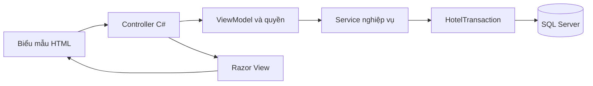
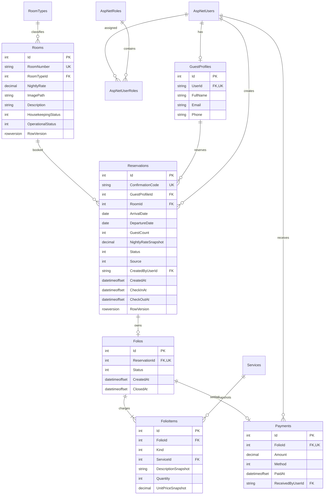
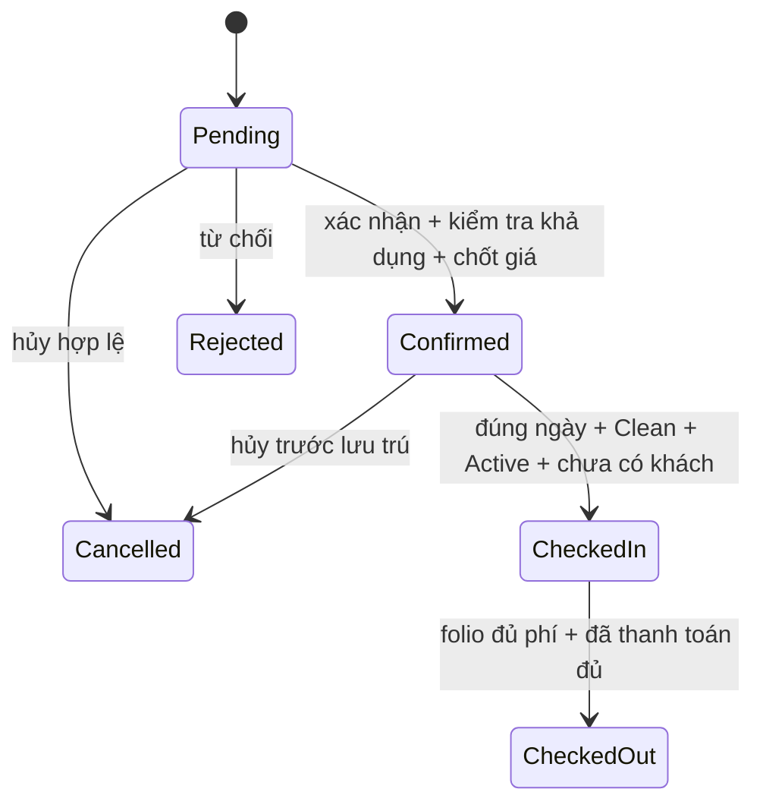
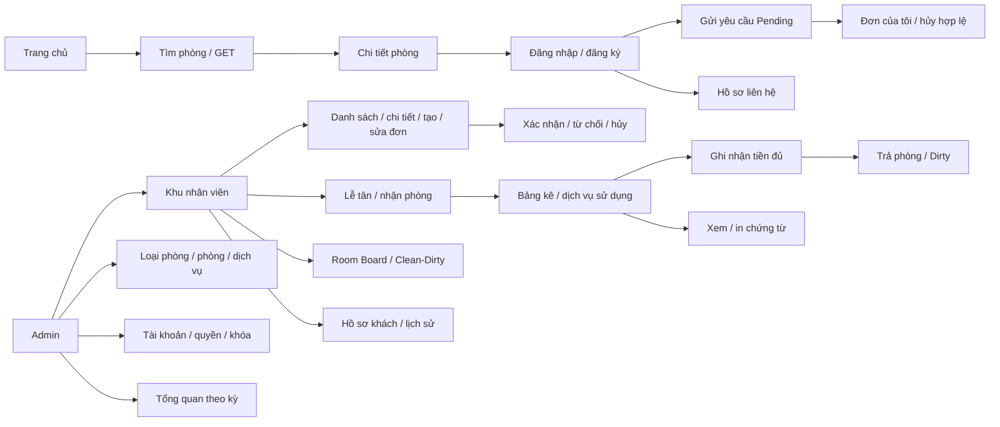

# Thiết kế kỹ thuật Aurora Hotel

## Kiến trúc và trách nhiệm

Ứng dụng MVC đơn giản cho một khách sạn. Mỗi entity, enum và view model có file riêng. Các lớp vẫn giữ namespace ổn định để dữ liệu và migrations tương thích bản cũ.

| Thành phần | Trách nhiệm |
|---|---|
| Controllers / Areas/Staff | Nhận request, kiểm tra ModelState/quyền, gọi service, trả trang hoặc redirect |
| ViewModels theo chức năng | Dữ liệu nhập với DataAnnotations và dữ liệu trang |
| RoomAvailabilityService | Kiểm tra kỳ ở, sức chứa, khoảng trùng lịch, lọc/phân trang |
| ReservationService | Tạo, sửa, xác nhận, hủy/từ chối đơn |
| FrontDeskService | Nhận phòng, bảng kê, dịch vụ, thu tiền, trả phòng |
| RoomStatusService | Dọn phòng và trạng thái khai thác |
| CatalogService / RoomImageService | Danh mục, lọc mô tả, kiểm tra và mã hóa lại ảnh |
| ReportService | Tổng quan và xuất CSV tiền đã thu |
| HotelTransaction | Giao dịch và khóa SQL chung cho thay đổi nghiệp vụ |
| HotelDbContext | Ánh xạ EF Core + Identity, ràng buộc và chỉ mục |
| Extensions | Đăng ký dependency, pipeline HTTP, khởi tạo môi trường |
| ConfirmSubmitTagHelper | Bước xác nhận HTML do C# tạo, dùng lại ở các biểu mẫu |
| Views / wwwroot/css | Razor tạo HTML và CSS chia theo màn hình |

`Program.cs` chỉ ghép cấu hình và khởi động. Seed chạy một lần ở Development hoặc qua lệnh bootstrap hosting có chủ đích. Không đổi schema trong lần tái cấu trúc này.

## Luồng một yêu cầu

Tìm kiếm dùng GET để giữ bộ lọc trong URL. JavaScript gửi AJAX và thay vùng kết quả bằng partial Razor do C# render; phân trang và Back/Forward giữ bộ lọc. Khi JavaScript không chạy, biểu mẫu và liên kết GET vẫn hoạt động. Các thay đổi dùng POST cùng antiforgery token. Gửi thành công rồi redirect để tải lại không gửi lại biểu mẫu. Giá và quyền sở hữu luôn đọc lại từ database.

Controller kiểm tra quyền qua `[Authorize]`, xác thực ModelState, đọc UserId từ claim rồi gọi service. Giá, chủ hồ sơ, tổng phải thu và trạng thái không lấy từ trường do trình duyệt tự quyết định. Server trả 400 cho validation/CSRF, 401/403 ở API và 404 khi khách truy cập đơn không thuộc mình; MVC dùng trang lỗi/redirect login theo Identity.

## ERD

UserId trên GuestProfile được null cho khách trực tiếp, unique có filter khi khác null. Không hợp nhất hồ sơ dựa theo email. Tiền là decimal(18,0). Ngày nghiệp vụ là SQL `date`; thời điểm là `datetimeoffset`. Ràng buộc check bảo vệ khoảng ngày, số khách/số lượng, giá trị tiền; khóa ngoại `Restrict` bảo toàn lịch sử. Có unique filtered index chỉ cho một Reservation CheckedIn mỗi RoomId và một dòng Kind=Room mỗi FolioId. Folio.ReservationId và Payment.FolioId unique.

## Trạng thái

Folio: Open → Paid → Closed. Open chỉ được chỉnh khi Reservation đang CheckedIn. Không sửa phí sau Paid. Một lần thanh toán đủ; gửi lại cùng số tiền/phương thức trả thành công mà không tạo bản ghi mới. Khác số tiền/phương thức sau khi đã thu bị từ chối. Check-in và checkout lặp lại không mở folio/thu phí/đổi housekeeping lần nữa.

Occupancy suy ra từ Reservation.Status=CheckedIn. Clean/Dirty không trộn vào occupancy. Active/OutOfOrder là khai thác; chuyển OutOfOrder bị chặn nếu còn Confirmed hoặc CheckedIn, kể cả Confirmed quá ngày chưa xử lý. Dirty không loại khỏi tìm kiếm tương lai.

## Chống thao tác đồng thời

Tất cả lệnh ghi nghiệp vụ qua `HotelTransaction.RunAsync`: bắt đầu transaction, lấy `sp_getapplock` Exclusive với LockOwner=Transaction và tài nguyên `AuroraHotel:operations`, đọc lại dữ liệu, kiểm tra, SaveChanges, Commit. Lỗi tự rollback. Transaction-scoped lock của SQL Server áp dụng giữa các process/server cùng database; không dựa vào semaphore trong bộ nhớ. Unique indexes là lớp bảo vệ bổ sung.

Đây là khóa chung cho một khách sạn, dễ đọc và dễ chứng minh tính đúng trong đồ án; đổi lại các ghi nghiệp vụ được tuần tự hóa. Nếu mở rộng tải cao, thay bằng khóa theo phòng/folio với thứ tự lấy khóa thống nhất và kiểm thử deadlock. Không thêm retry mù khi request có tác dụng phụ. Giá chốt chỉ đổi khi nhân viên chủ động thay phòng/lịch trước nhận phòng, và UI báo rõ chính sách.

## Sơ đồ trang

## Bảng quyền

| Nhóm chức năng | Chưa đăng nhập | Customer | Receptionist | Admin |
|---|---|---|---|---|
| Trang chủ/tìm/chi tiết | Có | Có | Có | Có |
| Đăng ký công khai | Chỉ Customer | Chỉ Customer | Chỉ Customer | Chỉ Customer |
| Đơn/hồ sơ cá nhân | Không | Chỉ của mình | Luồng nhân viên | Luồng nhân viên |
| Danh sách khách/đơn, điều hành lưu trú | Không | Không | Có | Có |
| Clean/Dirty | Không | Không | Có | Có |
| Folio/dịch vụ sử dụng/thu tiền/in | Không | Không | Có | Có |
| Catalog CRUD/OutOfOrder | Không | Không | Không | Có |
| Phân quyền/khóa/dashboard tổng hợp | Không | Không | Không | Có |

Không chỉ ẩn nút: server chặn từng controller/action. Customer truy vấn ID đơn luôn kèm điều kiện GuestProfile.UserId=claim UserId. Profile bỏ qua Id khách do client gửi. Admin không tự đổi quyền/khóa phiên đang dùng, không làm mất Admin hoạt động cuối cùng. Thay quyền/khóa cập nhật security stamp; cookie cũ mất hiệu lực khi request tiếp theo.

## Trang/API và HTTP

| Route | Method | Quyền / công dụng |
|---|---|---|
| `/`, `/Rooms`, `/Rooms/Details/{id}` | GET | Công khai, trang phòng |
| `/Account/Login`, `/Account/Register` | GET/POST | Identity, public role Customer |
| `/Account/Logout` | POST | Đã đăng nhập |
| `/Account/Profile` | GET/POST | Customer, hồ sơ của mình |
| `/Bookings/Select` | POST | Session giữ lựa chọn trước đăng nhập |
| `/Bookings/Create` | GET/POST | Customer, tạo Pending |
| `/Bookings`, `/Bookings/Details/{id}` | GET | Customer, chỉ đơn của mình |
| `/Bookings/Cancel/{id}` | POST | Customer, điều kiện hủy |
| `/Staff/Reservations/{action}/{id?}` | GET hoặc POST đúng hành động | Staff, CRUD nghiệp vụ đặt phòng |
| `/Staff/FrontDesk` | GET | Staff, tabs nhận/đang ở/trả |
| `/Staff/FrontDesk/CheckIn/{id}` | POST | Staff, nhận phòng |
| `/Staff/FrontDesk/Folio/{id}`, `Invoice/{id}` | GET | Staff, đọc/in; không tạo phí khi đọc |
| `/Staff/FrontDesk/Charge`, `UpdateCharge`, `DeleteCharge`, `Pay`, `CheckOut` | POST | Staff, id là folio ID |
| `/Staff/Board`, `/Staff/Guests` | GET | Staff |
| `/Staff/Board/Housekeeping/{id}` | POST | Staff |
| `/Staff/Board/Operation/{id}` | POST | Admin |
| `/Staff/Catalog/*`, `/Staff/Users/*`, `/Staff/Dashboard` | Theo action | Admin |
| `/api/rooms/availability` | GET | Public, SearchInput; JSON total/page/pageSize/pages/items |
| `/api/services`, `/api/services/{id}` | GET | Staff |
| `/api/services` | POST | Admin, ServiceInput; 201 + Location |
| `/api/services/{id}` | PUT | Admin, ServiceInput; 204 |
| `/api/services/{id}` | DELETE | Admin; xóa chưa dùng/ngừng nếu có lịch sử; 204 |

Tìm kiếm và phân trang dùng biểu mẫu GET. Link quay lại từ chi tiết giữ bộ lọc; return URL được kiểm tra nội bộ. Xem trước tiền phòng gửi POST với intent=preview và không tạo đơn. REST API vẫn dùng C#, kiểm tra quyền và token X-CSRF-TOKEN cho thao tác ghi; giao diện Razor dùng hidden token do Form Tag Helper tạo.

## Bảo mật, nhập liệu và quốc tế hóa

Identity cookie HttpOnly/SameSite Lax, lockout 5 lần đăng nhập thất bại trong 10 phút, mật khẩu >=8 với đủ thành phần, URL quay lại nội bộ. Toàn bộ POST/PUT/DELETE cookie được AutoValidateAntiforgeryToken. DataAnnotations/ViewModels hạn chế trường sửa; ORM truy vấn tham số. HTML mô tả chỉ cho p/br/b/strong/em/i/ul/ol/li/h3/h4, không cho thuộc tính/style/script/img. Nội dung còn lại Razor encode.

Upload JPEG/PNG/WebP tối đa 5 MB; kiểm tra extension và định dạng giải mã; giới hạn 8.000 px mỗi chiều/32 MP trước giải mã, tên UUID, ghi lại WebP vào static uploads. Không dùng tên file client, không giữ metadata hoặc file thực thi. CSP chỉ cho tài nguyên/script cùng nguồn; header nosniff/frame DENY. Không trả lỗi stack trace ra trình duyệt.

Nhãn nghiệp vụ ở Ui.Label; định dạng Ui.Date/Money/Time, văn hóa vi-VN, HotelClock dùng múi giờ cấu hình (mặc định Việt Nam). Để mở rộng ngôn ngữ: chuyển nhãn Views/DataAnnotations/Ui.Label sang Resources `.resx` + `IViewLocalizer`/`IStringLocalizer`, thêm supported cultures và kiểm thử từng ngôn ngữ. Hiện không có nút đổi ngôn ngữ.

## Quy ước mở rộng

Editor Quill chỉ tải ở màn hình thêm/sửa phòng. `room-editor.js` đồng bộ HTML từ editor vào textarea `Description`, sau đó form POST về CatalogController như trước. C# vẫn kiểm tra độ dài và lọc HTML; các định dạng cho phép gồm đoạn, đậm, nghiêng, tiêu đề và danh sách. Nếu thư viện không tải được, textarea gốc vẫn dùng được.

Sitemap có trong [sitemap.svg](sitemap.svg) và trang Sitemap của `diagrams.drawio`; đường nối thể hiện nhóm trang theo quyền, không phải thứ tự xử lý nghiệp vụ.

1. Thêm dữ liệu nhập vào ViewModels của đúng chức năng, kèm validation tiếng Việt.
2. Đặt quy tắc nghiệp vụ trong service tương ứng. Thao tác nhiều bản ghi dùng HotelTransaction.
3. Controller giữ ngắn: kiểm tra request, gọi service, thông báo và redirect.
4. Không nhận giá, chủ sở hữu hoặc quyền truy cập từ trường ẩn do trình duyệt gửi.
5. Khi sửa schema, tạo migration; không sửa migration đã áp dụng hoặc xóa database của người dùng.
6. Viết kiểm thử hành vi cho thay đổi nghiệp vụ. Chạy solution test trên database riêng.
7. Giữ giao diện bằng Razor/HTML/CSS. Dùng confirm-submit cho xác nhận; dùng CSS print cho chứng từ.

Namespace Models và ViewModels được giữ ổn định; thư mục con giúp tra cứu theo thực thể hoặc chức năng. Không tạo nhiều tầng repository chỉ để bọc lại EF Core.
